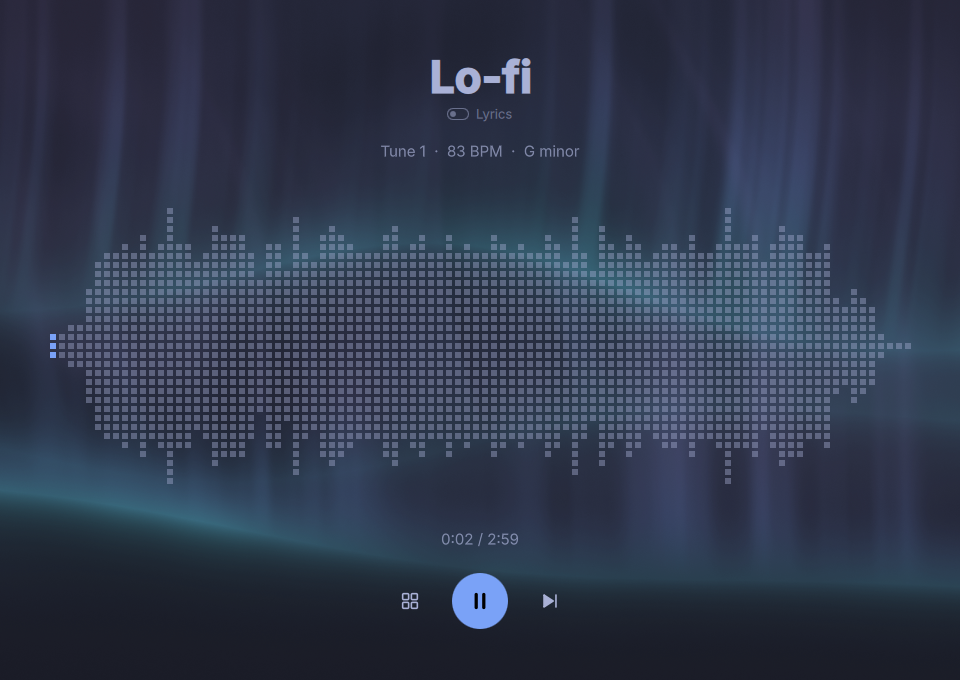

# Flowtunes

Endless music in the genre you pick, made on your own machine by Omarchy's local music model.



Pick a genre and the music never stops: ACE-Step 1.5 Turbo makes one tune after another, with lyrics or without, each a little different from the last, and always has the next two ready behind the one playing. Lo-fi, Ambient, Synthwave, Deep House, Techno, Drum & Bass, Jazz, Classical, Downtempo, Post-Rock, Acoustic and Cinematic are there to flow to.

Every tune is saved in a folder of its genre in your music, like `~/Music/Deep House/`, named for when it was made, its tempo and its key. A genre that has tunes from before plays those first, in a new order each time, before the model makes more. The model runs in [omarchy-local-ai](https://github.com/omacom/omarchy-local-ai), and Flowtunes starts it, or offers to set it up, when it isn't running.

`flowtunes jazz` opens playing a genre right away.

## Shortcuts

| Keys | Action |
| --- | --- |
| Arrows | Move between the genres |
| Enter | Play the genre |
| Space | Pause or play |
| N | Skip to the next tune |
| G | Pick another genre |
| L | Turn the lyrics on or off |
| ? | All shortcuts |
| Q | Quit |

## Building

```sh
bin/build                                  # builds into build/
bin/test                                   # builds, then runs the tests offscreen
cmake --install build --prefix ~/.local    # puts Flowtunes in the app launcher
```

It needs Qt 6 (base, declarative, multimedia, shadertools, svg) and `ffmpeg`.

## License

MIT.
